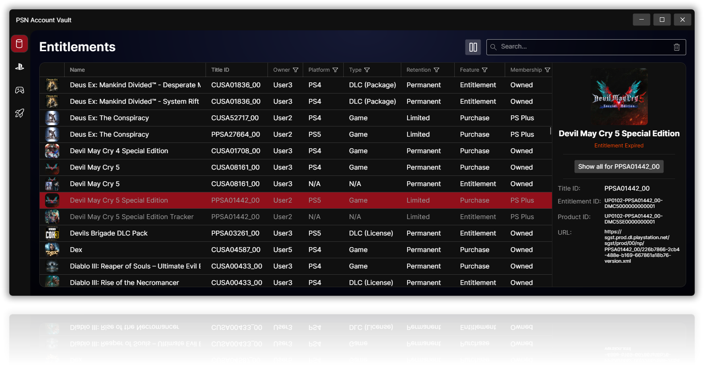

<div id="psnav-logo" align="center">
    <br />
    
    <h1>PSNav</h1>
    <h3>PSN Account Vault</h3>
    <h3>Utility to manage your multiple PSN accounts, purchases and more!</h3>
    
</div>

## Features

- **Accounts** - add PSN accounts using an NPSSO token and keep them all in one place.
- **Entitlements** - synchronize and browse games purchased on your accounts. Never buy the same game twice again!
- **Consoles** - import an entitlement database from your PS4/PS5 to get more detailed data about your purchases (e.g. DLCs, manifest URLs, expired entitlements, expiration dates, retention policies, membership).
- **Patches** - collect patch manifest URLs for the entitlements and submit the ones not yet sent to [prosperopatches.com](https://prosperopatches.com).

### Entitlement data sources and limitations

Entitlements can come from two sources, and they are **not equivalent**:

- **NPSSO token synchronization** - gets entitlements through the official mobile app's API (reverse-engineered).
  - It is convenient, but it returns only a partial set of data.
- **Console database import** - reads the `entitlement.db` (PS4) or `entitlement4.db` (PS5) file exported from a console.
  - Only this source guarantees full data coverage.
  - The PS4 database also includes PS5 entitlements.
  - It requires a **jailbroken** console.

For the most complete library, import the database from your console and use NPSSO synchronization to cover accounts you don't have console data for.

Profiles imported from a console can be linked to an account added with an NPSSO token, or to an offline account you create for this purpose.

## Download

Prebuilt, self-contained single-file builds are published on the [Releases](https://github.com/RobbedColek/PSNav/releases) page. No installation or .NET runtime is needed.

| Platform | Build |
|---|---|
| Windows (x64) | `PSNav-win-x64.zip` |
| Linux (x64) | `PSNav-linux-x64.tar.gz` |
| macOS (Apple Silicon) | `PSNav-osx-arm64.tar.gz` |
| macOS (Intel) | `PSNav-osx-x64.tar.gz` |

Extract the archive and run `PSNav`.

The nightly build is regenerated automatically from the latest commit and may be unstable.

## Setup

### Accounts

1. Go to the `Accounts` view by clicking the PSN icon in the left sidebar.
2. Click the `+` button in the top-right corner of the window and choose `Add PSN Account`.
    - `Add Offline Account` creates a placeholder entry in the database that can later be linked to a profile imported from a console database.
3. In the dialog, open the URL in a browser where you're logged in to your PSN account.
4. Copy the JSON shown on the page and paste it into the dialog. It should look like this:
    ```json
    { "npsso": "<NPSSO_TOKEN>;", "expires_in": XXXXXX }
    ```
5. Click `Add account`.
6. Once the account is added, click the sync icon (tooltip: `Synchronize`) in the top-right corner.
7. The data is pulled from the API and saved in the local database.

### Consoles

1. Go to the `Consoles` view by clicking the gamepad icon in the left sidebar.
2. Click the `+` button in the top-right corner of the window.
3. Enter a name for the console and the path to its `entitlement.db` or `entitlement4.db` file.
    - On a jailbroken console, the file can be found at `/system_data/priv/license`.
4. Click `Register`.
5. Once the console is registered, select it from the list.
6. Select one of the profiles in the profile list.
7. Click the field under the `Account ID` column to link the profile to an account.

## Your data

Everything is stored locally in a SQLite database named `PSNav.db` inside the `PSNav` folder of your application data directory (`%APPDATA%\PSNav` on Windows).

Images for your entitlements are downloaded and stored in the database during synchronization, for a smoother browsing experience at the cost of a larger database and a slower first synchronization.

Account NPSSO tokens are stored in that database as plain text, so keep the file private and don't share it.

## Building from source

Requires the [.NET 10 SDK](https://dotnet.microsoft.com/download).

The UI comes from the ColekUI git submodule, so clone with `--recursive` before building.

```bash
git clone --recursive https://github.com/RobbedColek/PSNav.git
git submodule update --init    # if you cloned without --recursive
dotnet run --project src/PSNav.csproj
```

To produce a single-file build for your platform:

```bash
dotnet publish src/PSNav.csproj -c Release -r win-x64 --self-contained true -o publish
```

Replace `win-x64` with `linux-x64`, `osx-arm64` or `osx-x64` as needed.

## Disclaimer

PSNav is an unofficial tool and is not affiliated with or endorsed by Sony Interactive Entertainment.

"PlayStation" and "PSN" are trademarks of their respective owners.

Use it only with accounts you own, and at your own risk.

## License

Released under the [GNU General Public License v3.0](LICENSE).
